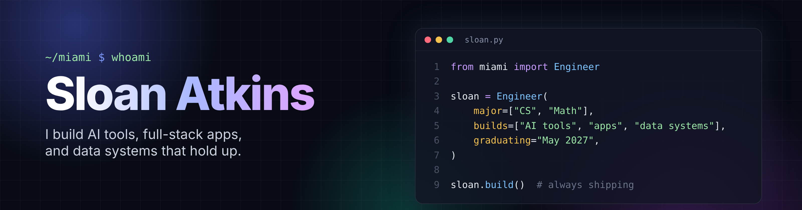

# Sloan Atkins

Computer Science and Mathematics student at the University of Miami building AI tools, full-stack apps, and data systems that solve real problems.

---

## About
I like building software people can use, from AI tools that check their own work to end-to-end data systems that ingest from APIs, model data with dbt, orchestrate with Airflow, and present results through dashboards. I care about tested code, clean data models, and READMEs someone else can actually follow.

I'm also building a background in cybersecurity. The two fields overlap more than people expect: access control, encryption, audit logging, and data governance all live inside the pipeline, so I want to build systems that are secure by design, not patched later.

- Based in Miami, FL
- Seeking software, AI, and data engineering roles starting after May 2027
- Currently studying for the AWS Certified Data Engineer Associate (DEA-C01) and CompTIA Security+

---

## Technical Focus
- LLM features with validated outputs, automated checks, and human review
- Full-stack apps with React, TypeScript, FastAPI, and Firebase
- ELT pipelines with cloud storage, warehouse modeling, and orchestration
- Dimensional modeling (star schemas) and dbt testing for data quality
- Interactive dashboards and BI reporting on modeled data
- Real-time streaming with Kafka and PySpark
- Containerized, CI-tested projects with Docker and GitHub Actions
- Data security: IAM, access control, and compliance-aware pipeline design

---

## Featured Projects

<table>
  <tr>
    <td width="50%" valign="top">
      <h3>Accessibility Fix Assistant</h3>
      

        Full-stack tool from my web job that scans a page with axe-core,
        explains each issue in plain English, drafts an HTML fix, and tests
        it on a temporary page copy before a person reviews it.
      

      
<strong>Tech:</strong> React, TypeScript, FastAPI, Playwright, axe-core, Groq, SQLite

      <a href="https://github.com/sloanatkins/a11y-fix-assistant">
        View Repository →
      </a>
      &nbsp;|&nbsp;
      <a href="https://a11y-fix-assistant.vercel.app/scans/library">
        Live Demo →
      </a>
    </td>
    <td width="50%" valign="top">
      <h3>Recipe Book</h3>
      

        Multi-user recipe app with shared cookbooks, role-based permissions,
        tested security rules, and AI import from links, screenshots, or
        PDFs with review before saving.
      

      
<strong>Tech:</strong> JavaScript, Firebase, Cloud Firestore, Cloudflare Workers, Groq

      <a href="https://github.com/sloanatkins/recipe-app">
        View Repository →
      </a>
      &nbsp;|&nbsp;
      <a href="https://recipe-book-e3d63.web.app">
        Live App →
      </a>
    </td>
  </tr>
  <tr>
    <td width="50%" valign="top">
      <h3>RetailLens</h3>
      

        End-to-end ELT analytics warehouse on the Olist e-commerce dataset.
        Raw data lands in S3, loads into Snowflake, and is modeled into a
        star schema with layered, tested dbt models feeding a business
        dashboard.
      

      
<strong>Tech:</strong> Python, AWS S3, Snowflake, dbt, Airflow, Streamlit, Plotly, Tableau, Docker

      <a href="https://github.com/sloanatkins/retaillens">
        View Repository →
      </a>
    </td>
    <td width="50%" valign="top">
      <h3>MacroLens</h3>
      

        Batch pipeline combining S&amp;P 500 sector ETF prices with FRED
        macroeconomic indicators. Scheduled with Airflow, transformed with
        dbt, and explored through an interactive dashboard.
      

      
<strong>Tech:</strong> Python, dbt, Airflow, Streamlit, Plotly, Power BI

      <a href="https://github.com/sloanatkins/macrolens">
        View Repository →
      </a>
    </td>
  </tr>
  <tr>
    <td width="50%" valign="top">
      <h3>StormStream</h3>
      

        Real-time streaming pipeline for U.S. weather alerts from the
        NOAA/NWS API. Kafka handles ingestion, PySpark processes the
        stream, and results land in Postgres.
      

      
<strong>Tech:</strong> Python, Kafka, PySpark, PostgreSQL, Docker, GitHub Actions

      <a href="https://github.com/sloanatkins/stormstream">
        View Repository →
      </a>
    </td>
    <td width="50%" valign="top">
      <h3>ModelWatch</h3>
      

        ML observability system that serves predictions through an API,
        logs every request, and flags feature drift using KS tests and
        Population Stability Index.
      

      
<strong>Tech:</strong> Python, FastAPI, Streamlit, Docker, GitHub Actions

      <a href="https://github.com/sloanatkins/modelwatch">
        View Repository →
      </a>
    </td>
  </tr>
</table>

---

## Core Technologies
**Languages:** Python, SQL, Java, JavaScript, TypeScript, C, C++  
**AI:** LLM APIs, Groq, Pydantic, structured outputs  
**Web:** React, FastAPI, Firebase, Cloudflare Workers, Playwright  
**Data Engineering:** dbt, Apache Airflow, Kafka, PySpark, Snowflake, PostgreSQL  
**Cloud &amp; DevOps:** AWS (S3), Docker, GitHub Actions, Linux/Unix, Git  
**Analytics &amp; BI:** Pandas, Streamlit, Plotly, Tableau, Power BI  
**ML:** scikit-learn, PyTorch, NumPy

---
<!--
## GitHub Activity

---
-->

## Links
- Resume: https://sloan-portfolio.web.app
- GitHub: https://github.com/sloanatkins
- LinkedIn: https://www.linkedin.com/in/sloan-atkins/
- Email: sloanatkins@gmail.com
